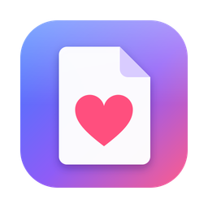
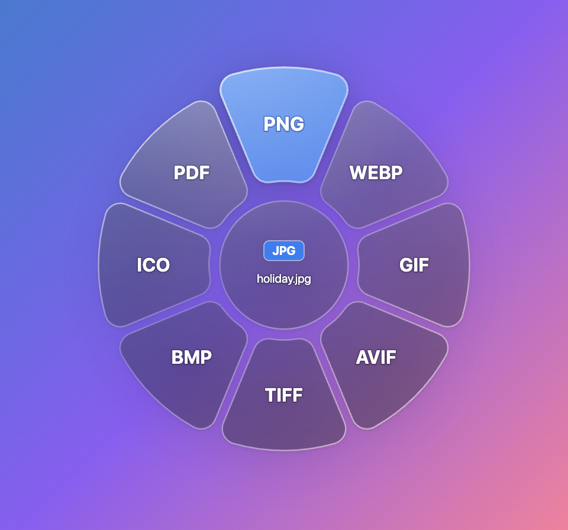

<p align="center">
  
</p>

<h1 align="center">I love files</h1>

<p align="center">
  Drag any file, press <kbd>C</kbd>, drop it on a format. Converted.<br>
  A tiny background app for <b>macOS</b> and <b>Windows</b>.
</p>

<p align="center">
  
</p>

## How it works

1. Start dragging any file (from Finder, Explorer or the desktop).
2. While still holding it, press **C**. A liquid-glass ring of the formats it can become appears around the file.
3. Move onto a format (it turns blue) and let go. The converted copy appears next to the original.
   The original is never changed and nothing is overwritten (`photo (1).png`). Let go in the centre, or press
   <kbd>Esc</kbd>, to cancel.

There's no window: it lives in the menu bar / system tray (♡), starts at login, and shows recent conversions and
progress there. Long conversions (video) keep running in the background and finish with a notification.

## Download

Get the installers from the [**Releases**](../../releases) page, along with `Install Guide.pdf`:

| Installer | For |
|---|---|
| `I love files - Mac (Apple Silicon).dmg` | Macs with M-series chips |
| `I love files - Mac (Intel).dmg` | Intel Macs |
| `I love files - Windows Setup.exe` | Windows 10 / 11 |

The builds aren't signed with an Apple Developer ID or a Windows code-signing certificate, so the first launch
needs one extra click (**Open Anyway** on Mac, **More info → Run anyway** on Windows), as the guide explains.
On macOS the app asks for **Accessibility** permission so it can notice the C key during a drag.

## Formats

| Kind | Reads | Converts to |
|---|---|---|
| Images | JPG PNG WEBP AVIF GIF TIFF BMP ICO SVG HEIC | JPG PNG PDF WEBP GIF AVIF TIFF BMP ICO |
| Audio | MP3 WAV M4A/AAC FLAC OGG OPUS AIFF WMA | the same audio formats |
| Video | MP4 MOV MKV WEBM AVI WMV FLV | MP4 MOV MKV WEBM AVI WMV, GIF, any audio format |
| Documents | DOCX MD TXT HTML PDF | DOCX → PDF/HTML/TXT · MD/TXT → PDF/HTML · HTML → PDF · PDF → PNG/JPG (per page)/TXT |
| With [LibreOffice](https://www.libreoffice.org) | + DOC ODT RTF, XLSX XLS ODS CSV, PPTX PPT ODP | Word ↔ PDF/DOCX/DOC/ODT/RTF/TXT/HTML · Excel ↔ PDF/XLSX/XLS/ODS/CSV · PowerPoint ↔ PDF/PPTX/PPT/ODP |

LibreOffice is detected automatically; when it's missing, the ring shows a **More…** shortcut to download it.

## Project structure

```
i-love-files/
├── src/
│   ├── main/                 Electron main process
│   │   ├── main.js           app lifecycle, tray, global drag + C detection, ring window, conversions
│   │   ├── drag-source.js    finds the dragged file (macOS drag pasteboard / Windows Explorer selection)
│   │   ├── converter.js      conversion engines: sharp, ffmpeg, LibreOffice, built-in docs & PDF
│   │   ├── electron-tools.js HTML → PDF printing and PDF rendering via hidden Chromium windows
│   │   └── formats.js        every supported format (extensions, MIME types, kind)
│   ├── preload/
│   │   └── preload.js        the small, safe API the ring page may call
│   └── renderer/
│       ├── overlay.html      the liquid-glass ring (styles + SVG gradients)
│       ├── overlay.js        ring layout, rounded zones, hover hit-testing, status
│       └── pdf-worker.html   pdf.js page renderer used for PDF → image/text
├── scripts/
│   ├── fetch-binaries.js     downloads ffmpeg + sharp binaries for every target platform
│   ├── build.js              builds the three installers into release/
│   └── make-guide.js         prints docs/install-guide.html to release/Install Guide.pdf
├── test/
│   └── convert.test.js       end-to-end conversion test across all file kinds
├── build/                    app icon (icon.svg source → icon.png), used by electron-builder
├── docs/
│   ├── install-guide.html    the user install guide (source of Install Guide.pdf)
│   └── images/               icon and screenshot used in the README and guide
├── package.json
└── README.md
```

Not in git (see `.gitignore`): `node_modules/`, `vendor/` (native binaries from `npm run setup`),
`dist/` and `release/` (build output; installers are published as GitHub Releases).

## Development

Requires [Node.js](https://nodejs.org) 20+.

```bash
npm install
```

```bash
npm start
```

The app starts in the menu bar / tray. On macOS, grant Accessibility permission when asked; in development the
entry may be called `Electron` (or your terminal app). Run with `DC_DEBUG=1 npm start` to log every step of the
drag + C detection.

```bash
npm test
```

Creates sample images, audio, video, Markdown, text, PDF (and on macOS a Word file), converts each to every
format the ring offers, and fails if any conversion breaks.

### How the drag is detected

macOS doesn't tell other apps about a Finder drag in progress (no mouse moves, no release, no drop events), so
the app tracks it itself: `uiohook-napi` sees the C key system-wide, a small persistent `osascript` helper reads
the drag pasteboard and real mouse-button state, the cursor is polled to highlight the zone under it, and the
conversion runs on release. Windows uses the same flow, with the foreground Explorer window's selection as the
dragged files.

## Building the installers

```bash
npm run release
```

This downloads any missing native binaries (`npm run setup`), builds all three installers into `release/` (from
a Mac, the Windows one included) and prints `Install Guide.pdf` next to them. To publish, create a GitHub
Release and attach the three installers and the guide.

Each installer carries only its own platform's native code (see `scripts/build.js`): its ffmpeg from
`vendor/ffmpeg/<platform>-<arch>/`, its sharp package from `node_modules/@img/`, and uiohook's prebuilt binary
(a locally compiled `uiohook-napi/build/` is excluded on purpose: it would be the wrong OS on other targets).
A plain `npm install` removes sharp's other-platform packages; `npm run setup` puts them back.

Self-test an installed build end to end (converts every file in a folder, writes `report.txt`, quits):

```bash
ILF_SELFTEST=/path/to/sample/files "/Applications/I love files.app/Contents/MacOS/I love files"
```

## Third-party software

Conversions are powered by [sharp](https://sharp.pixelplumbing.com) / libvips, [FFmpeg](https://ffmpeg.org)
(via [ffmpeg-static](https://github.com/eugeneware/ffmpeg-static); its license ships next to the binary),
[pdf.js](https://mozilla.github.io/pdf.js/), [mammoth](https://github.com/mwilliamson/mammoth.js),
[pdf-lib](https://pdf-lib.js.org), [marked](https://marked.js.org) and
[uiohook-napi](https://github.com/SnosMe/uiohook-napi), running on [Electron](https://www.electronjs.org).
The bundled FFmpeg build is GPL-licensed, which affects how the app may be redistributed. Keep that in mind
when choosing this project's license.
